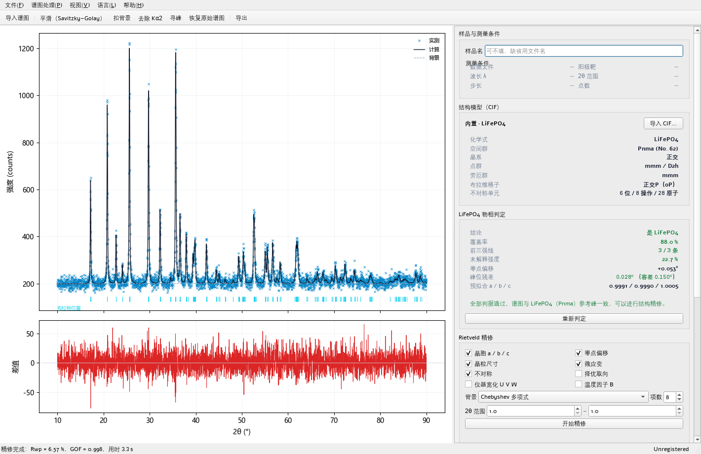

# PolyXRD LFP

**磷酸铁锂（LiFePO4，橄榄石型，Pnma）专用 XRD 数据处理与 Rietveld 结构精修工具。**

PolyXRD 家族成员。打开即一个界面：左侧谱图 + 谱图下方的样品条件与内置结构，右侧判定与
精修结果；导入谱图后**先判定是不是 LiFePO4，不是就停下**，是才允许以 CIF 为基础精修。



---

## 1. 为什么先判定再精修

Rietveld 拟合有能力把一个「不属于这条谱」的结构硬凑上去——参数照样收敛、Rwp 照样能
看，但得到的晶胞参数没有任何物理意义。所以在 PolyXRD LFP 里，判定是**闸门**而不是
「参考意见」：

- 导入谱图 → 自动判定 → 非 LiFePO4 则弹窗说明**为什么不是**，并锁死精修按钮；
- 判定通过后才解锁精修，且精修起点（晶胞预拟合、零点）来自判定阶段的匹配结果。

判定用四条可解释的判据，全部满足才放行（阈值冻结于 `lfp/core/identify.py`）：

| 判据 | 含义 | 阈值 |
|---|---|---|
| 覆盖率 coverage | 实测峰被 LFP 参考峰解释的强度占比（权重为计算相对强度） | ≥ 70 % |
| 前三强 top3 | 数据范围内计算谱最强 3 条线必须条条有实测峰对应 | 3 / 3 |
| 未解释强度 unexplained | 无法归属给 LFP 的实测峰强度占比（Kα1/Kα2 卫星峰豁免） | ≤ 35 % |
| 模型充分性 model_ok | 扣掉零点与各向同性胀缩后，配对峰峰位残差 RMS ≤ 0.45×位置容差 | ≤ 45 % |

前三条只数「有没有峰、强度够不够」，对**峰位系统性错位**不敏感；第四条补上这一课：
若样品发生明显各向异性形变（或叠了第二相），两参数模型压不住峰位偏差，此时按纪律
拒绝，而不是硬凑一个覆盖率交差。

判定结果把「未通过哪一条」直接写在面板与弹窗里，不会让用户对着一堆合格数字猜原因。

## 2. 功能

**左侧：谱图处理**（均为非破坏性，可一键恢复原始谱）

| 操作 | 方法 |
|---|---|
| 平滑 | Savitzky–Golay（窗口/阶数可调，窗口自动取奇） |
| 扣背景 | SNIP 迭代削峰 / 多项式拟合 / 端点线性 |
| 去 Kα2 | Rachinger 剥离（递推方向低角→高角，可选靶材与 I(α2)/I(α1)） |
| 寻峰 | `find_peaks` 定位 + 逐峰 pseudo-Voigt 拟合 + 线性背景，带质量闸门与位置去重 |
| 视图 | 「谱图」与「拟合结果」两态切换；拟合态显示实测 / 计算 / 背景 / 差值曲线与 Bragg 位置刻度 |

**谱图下方：结构模型**

- 内置 LiFePO4 CIF（`lfp/data/lfp.cif`，Pnma，No. 62，Z = 4）；
- 可导入自定义 CIF（自动读取空间群、晶胞、原子坐标、式量/矿物种名）；
- 与「样品与测量条件」并排显示；判定卡片、对称性卡片（晶系 / 空间群 / 点群 / 劳厄群 /
  布拉维格子）与精修面板在右栏。

**精修**（Rietveld 全谱拟合，变量投影最小二乘：线性层解析解结构因子尺度与背景系数，
非线性层 `scipy.optimize.least_squares`）

可勾选精修参数：晶胞 a/b/c、零点、晶粒尺寸（Scherrer）、微应变（Wilson）、
低角不对称、March–Dollase 择优取向（020）、仪器宽化 U/V/W、整体温度因子 B；
峰形 η 与背景项数随配置一并优化。

## 3. 结果与口径

精修完成后给出：晶胞 a/b/c 与 α/β/γ、体积、晶系、空间群（含 ITA 编号）、点群
（含 Schönflies 符号）、劳厄群、布拉维格子、晶粒尺寸、微应变，以及

- **Rwp / Rp / Rexp / χ² / GOF**：按 GSAS-II 口径（背景计入、`w = 1/σ²`、
  `σ = √max(y, 1)`、`Rexp = 100·√((N−P)/Σw·y_o²)`、`GOF = Rwp/Rexp`）；
- **R_Bragg**：profile-partitioned，重叠峰按峰高振幅分摊、已换算「计数·度」。

Rwp 绝对值与计数统计强相关，因此界面同时给 GOF 判读档位：Rwp 高但 GOF ≤ 1.2 时提示
「拟合已充分，Rwp 高是计数统计所限」，而不是一味说「拟合差」。

**导出**：HTML 报告（内嵌拟合图、判定证据链、精修参数清单、晶胞/对称性/微结构表、
Bragg 表）、结果摘要 CSV、实测/计算/差值/背景 CSV、Bragg 表 CSV、寻峰表 CSV、
拟合图 PNG。

## 4. 运行

```bat
:: 源码运行（需 numpy / scipy / matplotlib / PySide6）
python -m lfp.gui

:: 打包为单文件 exe（产物 dist\PolyXRD-LFP-vX.Y.Z.exe）
build_exe.bat
```

## 5. 开发与测试

```bat
python -m pytest tests\ -q              :: 全量（79 项）
python -m pytest tests\ -q -m "not slow" :: 跳过耗时用例
python tools\diag_identify.py           :: 判定回归表（阈值都由这张表定）
```

真实仪器谱回归需要指向导出目录（不存在时相关用例自动 skip）：

```bat
set POLYXRD_LFP_DATA=D:\Project\XRD\XRData\smz geshi
```

测试文件即文档：`tests/test_identify.py` 用正例与负例同时锁住判定纪律
（「该判过的一定判过，不该判过的绝不能判过」），`test_rfactors.py` 锁住 R 因子口径，
`test_processing.py` 锁住 Kα2 剥离的方向与幂等性。

## 6. 已知限制

- 判定针对**单相 LiFePO4**；含明显第二相（FePO4、碳包覆副产物等）的谱会被判否，
  这是设计选择（宁可漏判由用户手动放行，不可错判一路精修）；
- 峰形为 pseudo-Voigt + Caglioti，未做仪器标定；无标样时建议只放开 U/V/W 中的一项；
- 温度因子 B 与晶粒尺寸强相关，默认关闭，放开时易发散；
- 不处理 Kβ 残余、Ni 滤片吸收、荧光背景等仪器效应（先用谱图处理规避）。

## 7. 目录

```
lfp/
  core/            衍射内核：io / processing / peaks / identify / symmetry
    profile/       CIF 解析、晶胞与反射表、峰形、结构因子
    refine/        线性层、非线性层、R 因子、R_Bragg、对外 API
  gui/             单窗口界面：main_window / panels / canvas / dialogs / report / exports
  data/lfp.cif     内置 LiFePO4 结构
  i18n/            中英双语文案（键集必须一致，缺键显示 ⟪key⟫）
resources/         品牌资产（icon / logo / splash / hero，由 tools/build_artwork.py 生成）
tools/             build_artwork.py（品牌图）、diag_identify.py（判定回归表）
tests/             pytest（真实谱回归需 POLYXRD_LFP_DATA）
docs/              METHOD.md（算法与口径）、VALIDATION_v1.0.0.md（验证记录）、evidence/
```

## 8. 变更记录

| 版本 | 变更 |
|---|---|
| 1.1.0 | 布局调整：样品与测量条件、结构模型移到谱图下方并排，右栏只留判定 / 精修 / 结果，横向不再拥挤；修复卡片分组标题（晶胞参数、测量条件等）压在第一行数据上的显示缺陷；语言切换后结构与判定卡片按当前语言重渲染 |
| 1.0.0 | 首发：中日英三语、判定闸门、Rietveld 精修、内部评估版 / 安装注册版双版次 |

## 9. 许可与联系

- 许可：见 [LICENSE](LICENSE) / [LICENSE-CN](LICENSE-CN)
- 版权：© 2026 PolyXRD Team
- 联系：sshztx@outlook.com · https://github.com/PolyXRD
