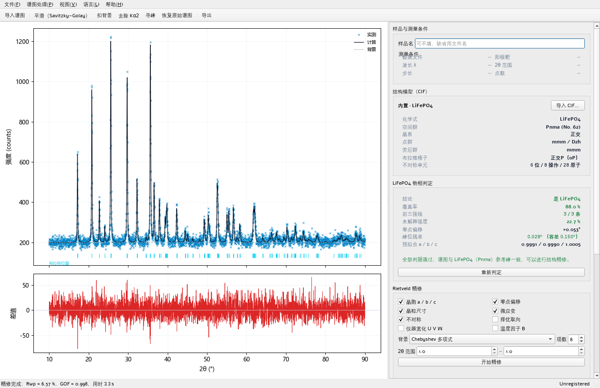

# PolyXRD LFP

**A dedicated XRD data processing and Rietveld structure refinement tool for lithium iron phosphate (LiFePO4, olivine type, Pnma).**

A member of the PolyXRD family. It opens to a single interface: pattern on the left + sample conditions and built-in structure below the pattern, identification and
refinement results on the right; after importing a pattern it **first determines whether it is LiFePO4, and stops if not**, allowing CIF-based refinement only when it is.



---

## 1. Why identify before refining

Rietveld fitting can force a structure that "does not belong to this pattern" onto it — parameters still converge, Rwp still looks
fine, but the resulting unit-cell parameters have no physical meaning. So in PolyXRD LFP, identification is a **gate**, not a
"suggestion":

- Import pattern → automatic identification → if not LiFePO4, a pop-up explains **why not** and locks the refine button;
- Refinement unlocks only after identification passes, and the refinement starting point (unit-cell pre-fit, zero point) comes from the identification-stage match.

Identification uses four interpretable criteria, all of which must be satisfied to pass (thresholds frozen in `lfp/core/identify.py`):

| Criterion | Meaning | Threshold |
|---|---|---|
| Coverage coverage | Fraction of measured-peak intensity explained by LFP reference peaks (weighted by calculated relative intensity) | ≥ 70 % |
| Top-3 strongest top3 | The 3 strongest calculated lines within the data range must each have a corresponding measured peak | 3 / 3 |
| Unexplained intensity unexplained | Fraction of measured-peak intensity that cannot be assigned to LFP (Kα1/Kα2 satellite peaks exempt) | ≤ 35 % |
| Model adequacy model_ok | After removing zero point and isotropic expansion/contraction, paired-peak position residual RMS ≤ 0.45× position tolerance | ≤ 45 % |

The first three only count "is there a peak, is the intensity enough" and are insensitive to **systematic peak-position shifts**; the fourth makes up for this:
if the sample has obvious anisotropic deformation (or an overlapping second phase), the two-parameter model cannot suppress the position deviation, and discipline requires
rejection rather than forcing a coverage figure to pass.

The identification result writes "which criterion failed" directly into the panel and pop-up, so users do not have to guess the reason from a pile of passing numbers.

## 2. Features

**Left: pattern processing** (all non-destructive, one click restores the original pattern)

| Operation | Method |
|---|---|
| Smoothing | Savitzky–Golay (window/order adjustable, window auto-set to odd) |
| Background subtraction | SNIP iterative peak clipping / polynomial fitting / endpoint linear |
| Kα2 removal | Rachinger stripping (recursion direction low angle → high angle, selectable target and I(α2)/I(α1)) |
| Peak finding | `find_peaks` localization + per-peak pseudo-Voigt fitting + linear background, with a quality gate and position de-duplication |
| View | Toggles between "Pattern" and "Fit result" states; the fit state shows measured / calculated / background / difference curves and Bragg position ticks |

**Below the pattern: structure model**

- Built-in LiFePO4 CIF (`lfp/data/lfp.cif`, Pnma, No. 62, Z = 4);
- Custom CIF import (automatically reads space group, unit cell, atomic coordinates, formula weight / mineral species name);
- Displayed side by side with "Sample and measurement conditions"; the identification card, symmetry card (crystal system / space group / point group / Laue group /
  Bravais lattice) and refinement panel are in the right column.

**Refinement** (Rietveld full-pattern fitting, variable-projection least squares: the linear layer solves the structure-factor scale and background coefficients analytically,
the non-linear layer uses `scipy.optimize.least_squares`)

Refinable parameters can be checked off: unit cell a/b/c, zero point, crystallite size (Scherrer), microstrain (Wilson),
low-angle asymmetry, March–Dollase preferred orientation (020), instrumental broadening U/V/W, overall temperature factor B;
the peak-shape η and the number of background terms are optimized along with the configuration.

## 3. Results and conventions

After refinement it gives: unit cell a/b/c and α/β/γ, volume, crystal system, space group (with ITA number), point group
(with Schönflies symbol), Laue group, Bravais lattice, crystallite size, microstrain, and

- **Rwp / Rp / Rexp / χ² / GOF**: following the GSAS-II convention (background included, `w = 1/σ²`,
  `σ = √max(y, 1)`, `Rexp = 100·√((N−P)/Σw·y_o²)`, `GOF = Rwp/Rexp`);
- **R_Bragg**: profile-partitioned, overlapping peaks apportioned by peak-height amplitude, converted to "counts·degrees".

The absolute value of Rwp is strongly correlated with counting statistics, so the UI also gives a GOF interpretation tier: when Rwp is high but GOF ≤ 1.2 it hints
"the fit is adequate; the high Rwp is limited by counting statistics", rather than simply saying "poor fit".

**Export**: HTML report (embedded fit plot, identification evidence chain, refinement parameter list, unit-cell/symmetry/microstructure table,
Bragg table), result-summary CSV, measured/calculated/difference/background CSV, Bragg table CSV, peak table CSV,
fit plot PNG.

## 4. Running

```bat
:: Run from source (requires numpy / scipy / matplotlib / PySide6)
python -m lfp.gui

:: Package as a single-file exe (artifact dist\PolyXRD-LFP-vX.Y.Z.exe)
build_exe.bat
```

## 5. Development and testing

```bat
python -m pytest tests\ -q              :: full suite (79 tests)
python -m pytest tests\ -q -m "not slow" :: skip time-consuming cases
python tools\diag_identify.py           :: identification regression table (all thresholds are set by this table)
```

Real-instrument pattern regression needs to point to the export directory (when it does not exist, the related cases are skipped automatically):

```bat
set POLYXRD_LFP_DATA=D:\Project\XRD\XRData\smz geshi
```

Test files are documentation: `tests/test_identify.py` pins the identification discipline with both positive and negative cases
("what should pass must pass, what should not pass must never pass"), `test_rfactors.py` pins the R-factor conventions,
and `test_processing.py` pins the direction and idempotence of Kα2 stripping.

## 6. Known limitations

- Identification targets **single-phase LiFePO4**; patterns with an obvious second phase (FePO4, carbon-coating by-products, etc.) are rejected —
  this is a design choice (better to miss and let the user override manually than to misidentify and refine all the way);
- The peak shape is pseudo-Voigt + Caglioti, with no instrument calibration; without a standard sample it is recommended to release only one of U/V/W;
- The temperature factor B is strongly correlated with crystallite size, off by default, and prone to divergence when enabled;
- Instrument effects such as Kβ residue, Ni filter absorption and fluorescence background are not handled (avoid them first via pattern processing).

## 7. Directory layout

```
lfp/
  core/            Diffraction kernel: io / processing / peaks / identify / symmetry
    profile/       CIF parsing, unit cell and reflection table, peak shape, structure factor
    refine/        Linear layer, non-linear layer, R factors, R_Bragg, public API
  gui/             Single-window UI: main_window / panels / canvas / dialogs / report / exports
  data/lfp.cif     Built-in LiFePO4 structure
  i18n/            Chinese-English bilingual copy (key sets must match, missing keys shown as ⟪key⟫)
resources/         Brand assets (icon / logo / splash / hero, generated by tools/build_artwork.py)
tools/             build_artwork.py (brand images), diag_identify.py (identification regression table)
tests/             pytest (real-pattern regression needs POLYXRD_LFP_DATA)
docs/              METHOD.md (algorithms and conventions), VALIDATION_v1.0.0.md (validation record), evidence/
```

## 8. Change log

| Version | Changes |
|---|---|
| 1.1.0 | Layout adjustment: sample and measurement conditions, structure model moved below the pattern side by side; right column keeps only identification / refinement / results, no longer crowded horizontally; fixed a display defect where card group titles (unit-cell parameters, measurement conditions, etc.) were pressed onto the first data row; after a language switch the structure and identification cards are re-rendered in the current language |
| 1.0.0 | First release: trilingual (Chinese / Japanese / English), identification gate, Rietveld refinement, internal evaluation build / installed registered edition dual editions |

## 9. License and contact

- License: see [LICENSE](LICENSE) / [LICENSE-CN](LICENSE-CN)
- Copyright: © 2026 PolyXRD Team
- Contact: sshztx@outlook.com · https://github.com/PolyXRD
